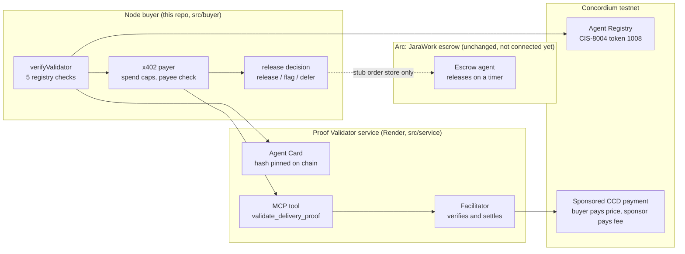
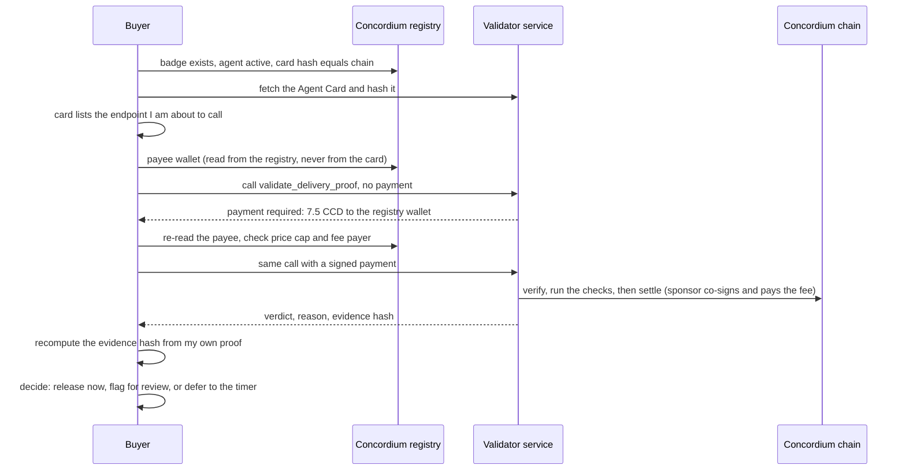

# Architecture

## The pieces

The dashed line is the honest gap: the decision logic exists and is tested, but it runs against a stub order store. Nothing here touches the JaraWork escrow or any mainnet.

## One decision, step by step

## What is real and what is simulated

| Part | Status |
| --- | --- |
| Agent registration, badge, pinned card hash | Real, on Concordium testnet |
| Sponsored x402 payment, fee split from the chain | Real, on Concordium testnet |
| Payee read from the registry, hostile-buyer refusals | Real |
| Link check (guarded request, internal addresses refused) | Real network request |
| IPFS retrieval through public gateways | Real, but public gateways often rate-limit servers ("try later", not charged) |
| Carrier delivery status | Simulated stub, and every such verdict says so |
| Order store and the Arc escrow link | Stub; not connected |

## Safety properties that are tested

- A verdict can only be fetched again by the payer who paid, with a payment whose signature verifies, once.
- Malformed input and inconclusive checks are answered but not charged.
- A refused or unverifiable validator is never paid: the order falls back to the existing timer.
- The buyer never pays an address the server or the card names; it pays what the registry says.
- Server fetches refuse internal addresses, re-check every redirect, and connect only to the address they checked.
