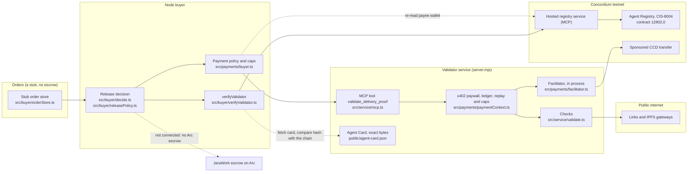
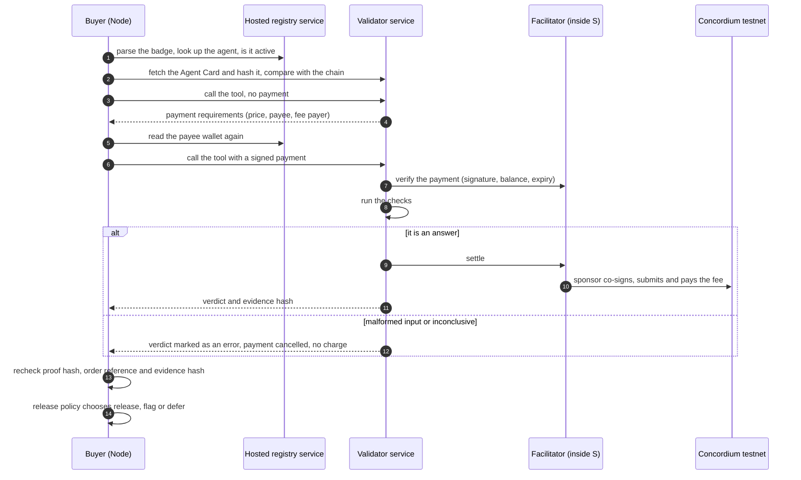
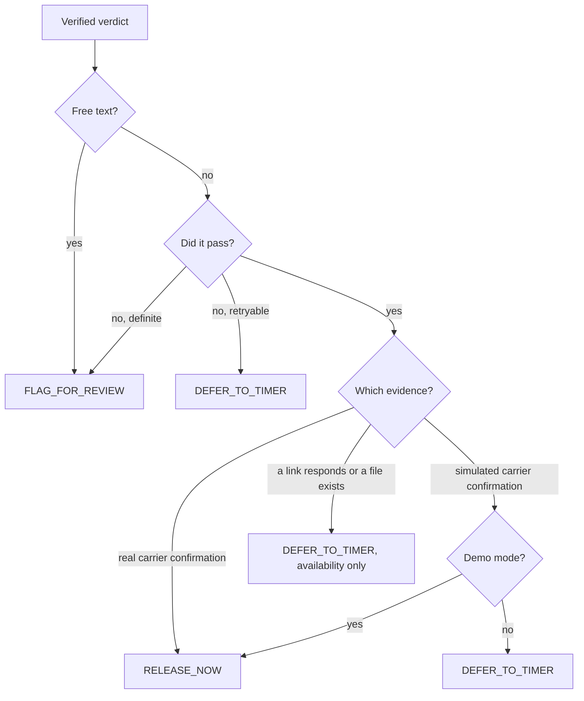

# Architecture

Everything drawn here exists in the code. A dotted line marked "not connected" is a gap, not a feature. File paths are in the node labels. The README's "Safety rules enforced in code" table lists the tests.

## Components

What is simulated: the carrier delivery status inside `checks` (`src/service/probes.ts`). Everything else on the diagram is real code and ran against testnet.

## One decision, step by step

## How a verdict becomes a decision

Today carrier status is simulated, so outside demo mode nothing reaches `RELEASE_NOW`. An unverifiable validator, a refused payment, a failed call or a verdict that does not match its proof also defer (`src/buyer/decide.ts`).

## Trust boundaries

| Boundary | What crosses it | Control |
| --- | --- | --- |
| Buyer to validator service | A signed payment and a proof | The payee comes from the registry, caps and a payment policy apply (`src/payments/buyer.ts`). |
| Validator service to the public internet | Requests to links and IPFS gateways named by a stranger | Public addresses only, a pinned connection, re-checked redirects (`src/service/realProbes.ts`). |
| Anyone to the service | Unpaid calls, payment-bearing calls, the free preview | Three separate rate budgets (`src/service/admission.ts`). |
| Service to Concordium | Reads, and a sponsored transfer | The sponsor key is an environment variable (`src/payments/config.ts`). |
| This module to the real escrow | Nothing | The stub store refuses to start near mainnet settings (`src/buyer/orderStore.ts`). |
